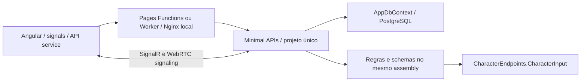

# Arquitetura de partida — auditoria de 04/11/2026

Referência anterior à migração: commit `f3f51ae`. A auditoria inspecionou a árvore completa de fontes, configuração, migrations, endpoints, autenticação, renderizadores e scripts. Não há `AGENTS.md` nem grafo Graphify preexistente. PDFs locais não são fontes de código nem entram no Git.

## Stack efetivamente encontrada

| Área | Implementação encontrada |
| --- | --- |
| Web | Angular 21 standalone, TypeScript 5.9, Signals, RxJS, Forms e Angular Router; CSS/SCSS próprios |
| API | ASP.NET Core Minimal APIs, .NET 10, projeto único `api/Chronicles.Api` |
| Dados | EF Core 10.0.13, Npgsql EF provider 10.0.3, PostgreSQL; Compose usa PostgreSQL 17 |
| Identidade | Cookie HttpOnly `chronicles_session`, token aleatório de 256 bits, apenas SHA-256 no banco; expiração/revogação de sessões; ASP.NET PasswordHasher |
| Realtime/mídia | SignalR com autorização de campanha/sessão, salas em memória e WebRTC mesh no navegador; retratos/fundos por URL HTTPS |
| Entrega | Docker, Compose com Mailpit, GitHub Actions, API Render e frontend Cloudflare Pages/Worker; proxy de identidade assinado |
| Testes | Executável .NET de regras; scripts Node de contrato/proxy/smoke; Playwright/Chrome com API/PostgreSQL reais e capturas |

Não há Spring/Java, Kafka, Redis, Kubernetes, storage S3 ou microsserviços no código. Variáveis legadas de RealtimeKit no Compose não comprovam uso atual de um serviço de mídia remoto.

## Topologia e fluxos

`Program.cs` mistura composition root, middleware, autenticação, perfil, dashboard e CRUD de campanhas. Outros endpoints são extensões estáticas no diretório raiz. Autorização é feita no servidor consultando memberships e propriedade, mas as consultas/políticas são repetidas em vários módulos. O frontend concentra contratos HTTP e métodos em `api.ts`; páginas e componentes vivem majoritariamente em um diretório plano.

- Cadastro/login: endpoints validam entrada, persistem usuário/hash e criam uma sessão; o middleware resolve o cookie antes do rate limiter. Logout/revogação também retiram conexões das salas.
- Campanhas/convites: usuário autenticado cria campanha com membership owner; o aceite verifica token, papel e participação antes de ingressar. Guards de UI preservam `returnUrl`, mas não substituem as checagens do servidor.
- Personagens: campanha/proprietário associados relacionalmente; formulário/autosave envia estado, campos e versão. API valida esquema/fórmulas/permissões e captura revisão antes da alteração.
- Fichas: `RpgSystem.SchemaJson` identifica template, versão de template, edição e layout. Campos do personagem usam JSONB. `SheetSchemaMigration` aplica renomes/conversões explícitas com histórico. NPCs têm schema próprio de ameaça e snapshots privados.
- Regras: `CharacterRuleEndpoints` consulta acesso/sistema, chama `SheetRuleActions`, valida resultado, atualiza ficha e grava dados na mesma transação de SaveChanges. Ameaças e manobras têm fluxos equivalentes próprios.
- Rolagens: RNG criptográfico no servidor; expressões limitadas; registro/idempotência por campaign/user/requestId e privacidade de campanha, mestre ou autor.

## Persistência

22 entidades centrais: User, UserSession, PasswordResetCode, Campaign, CampaignMembership, Character, CharacterSecret, Npc, CharacterFavorite, CharacterInventoryItem, CharacterAbility, CampaignInvite, NarrativeEntry, DiceRoll, RpgSystem, World, WorldArticle, WorldArticleLink, ChatMessage, Encounter, EncounterParticipant e CharacterRevision. `AppDbContext` centraliza configuração, FKs, índices e constraints. Campos específicos, templates e snapshots usam JSONB. Versões de personagens, NPCs, inventário/habilidades e schema do sistema são tokens de concorrência.

Há 46 arquivos de migrations contando designers e snapshot. IDs das migrations e contratos relacionais existentes devem permanecer estáveis. A API aplica `MigrateAsync` no startup, inclusive em produção: isso precisa de uma política explícita de release. Não há mecanismo durável de eventos/outbox. Histórico de ficha e rollback de banco são responsabilidades distintas.

## Diagnóstico

1. O núcleo de regras é amplamente puro e tem testes, mas depende nominalmente de DTO HTTP e do assembly Web. Isso impede testar/consumir o domínio isoladamente.
2. Schemas, regras, apresentação e seleção de versões estão distribuídos entre `SystemDefinition`, `SheetRuleActions`, `sheet-renderer-registry.ts`, templates e condicionais nas páginas. Adicionar RPG exige editar vários pontos centrais.
3. Todos os endpoints conhecem o mesmo DbContext e modelos de persistência, atravessando contextos diretamente. Não há contratos de aplicação para operações transversais.
4. EF models têm navegações entre contextos; são modelos relacionais de um monólito, não agregados de domínio isolados. Separá-los fisicamente sem adapters causaria alterações de schema e risco desnecessário.
5. A detecção inicial de imports TypeScript não encontrou ciclos no diretório de componentes; não equivale a um teste automatizado contínuo. No backend, o acoplamento é principalmente dentro do assembly único.
6. Realtime autentica salas e revoga sessões, mas seu registro em memória não é compartilhado entre instâncias. Não há stream durável de alterações de ficha nem ressincronização orientada por revisão.
7. Observabilidade tem health check de banco e logs padrão, mas faltam correlação uniforme, métricas próprias e contratos de eventos. Não há storage de upload gerenciado: não criar um módulo de S3 fictício.
8. O contrato atual liga a ficha ao sistema da campanha. Históricos preservam estado, mas não constituem snapshots independentes de todas as versões de schema. Metadados de versão precisam ficar explícitos nos contratos novos sem reatribuição silenciosa de campanhas.

## Elementos preservados e reutilizados

Interpretadores seguros de dados/fórmulas; regras puras dos quatro RPGs e ameaças; JSONB/validação de coleções; histórico e concorrência otimista; autorização por recurso; privacidade das rolagens; renderizadores visuais distintos; editor universal; OBS; proxy assinado; guards de navegação; suítes de regressão reais.

## Migração sem perda de dados

Extrair o núcleo e os contratos sem alterar o JSON público; separar domínio/aplicação/adapters por referências de projeto verificáveis; mover persistência preservando nomes de tabelas, IDs de migrations e snapshot; registrar plugins confiáveis por identificador/edição/schema; migrar fluxos reais para casos de uso. Introduzir eventos com payload mínimo e publicação somente após commit, usando uma outbox aditiva quando habilitada. Preservar `/api` e acrescentar contratos `/api/v1`. Reorganizar o frontend com pontos de compatibilidade para imports e sem substituir as fichas por formulário genérico.

Cada etapa exige build, testes de arquitetura/regras, migrations em banco local e testes de API/UI. SQL de migração e configuração operacional devem ser revisáveis; não fazer backfill, exclusão ou reatribuição automática de dados de produção. A situação de cada etapa e as fronteiras ainda legadas ficarão explícitas em `MIGRATION_PLAN.md`.
