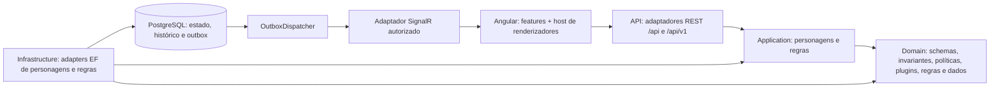

# Arquitetura implementada e direção de evolução

A base permanece um monólito modular Angular 21/.NET 10/PostgreSQL. As fatias hexagonais em execução abrangem criação, leitura, salvamento, lista, duplicação, histórico/restauração, inventário, habilidades, favoritos, notas privadas e OBS de personagens, além da consulta/execução de regras. A modularização completa dos demais CRUDs ainda não terminou. Não há microsserviços, broker, gateway ou segunda stack introduzidos por esta mudança.

As setas de dependência de código apontam para dentro: Domain não referencia projetos/pacotes externos; Application referencia apenas Domain; Infrastructure implementa as portas de Application. API é composition root e contém adaptadores HTTP/SignalR. A chamada ao banco durante execução usa a porta `ICharacterRuleStore`, não entidades EF ou DTOs ASP.NET no núcleo.

Os projetos ficam em `api/Chronicles.Api/modules/` para preservar o contexto Docker já configurado no Render. `Chronicles.Api.csproj` exclui os fontes internos da própria compilação e referencia os projetos explicitamente. Não se trata de compilar a mesma classe em dois assemblies.

## Separações que funcionam hoje

- **Schema:** `SystemDefinition`, `SystemField`, coleções, fórmulas e migrações de campos são tipos puros em Domain.
- **Rules:** motores existentes OP 1.3, D&D 2014, T20 JdA 2024 v1.3 e CoC 7e foram extraídos sem alterar suas fórmulas. Registry resolve ID estável + edição + versão de template; versões desconhecidas não executam regras.
- **Application:** `CreateCharacter`, `ReadCharacter`, `SaveCharacter`, `ReadCharacterLifecycle`, `DuplicateCharacter`, `RestoreCharacter`, `ReadCharacterRules` e `ExecuteCharacterRule` usam portas específicas, compartilhando `CharacterSheetSnapshot` e projeções de consulta. Comandos verificam acesso, revisão, privilégios de mestre e validação antes de persistir. Leitura de ficha não depende de executar/descrever regras. Duplicação conserva o estado persistido; restauração valida o arquivo e reutiliza o commit de escrita existente.
- **Persistence:** modelos relacionais EF e todas as migrations estão em Infrastructure. Seus namespaces/nomes de CLR anteriores são mantidos deliberadamente, evitando renomear entidades no modelo existente.
- **Version binding:** captura JSONB imutável e vínculo nullable por personagem, com fallback legado. `PinCharacterSystem` verifica mestre/identidade/revisões; `ReadCharacterSystem` fornece o modelo efetivo ao editor. Regras, OBS, cópia, exportação e encontros seguem esse vínculo. A atualização do template não migra fichas fixadas.
- **Character assets:** casos de uso específicos de inventário/habilidades, valores validados em Domain e adapters EF transacionais. A capacidade é verificada sob lock do personagem, com revisão independente de cada filho. As rotas e componentes Angular existentes foram preservados.
- **Companions/OBS:** portas de favoritos/segredos/capacidades, política explícita de membro/mestre/dono e geração criptográfica isolada. A projeção OBS está em Application e usa o registry versionado; endpoints não fazem cálculos nem consultam EF. O editor envia o indicador de existência das notas para resolver a ambiguidade da revisão inicial legada.
- **Presentation:** host Angular cria componentes próprios OP/D&D/CoC/T20, reaproveita suas instâncias e conecta outputs de edição/restauração/ocupação. O editor de personagem não importa layouts concretos. Templates livres mantêm o editor visual.
- **Events:** ponte de transição transforma alterações EF em envelopes versionados gravados na mesma transação. Consumidor autorizado invalida fichas por SignalR; cliente busca novamente o estado do servidor.

## Limites atuais

`Features/*` organiza os adaptadores por responsabilidade, mas organização em pastas não significa isolamento completo de bounded contexts. Endpoints legados ainda acessam o `AppDbContext` compartilhado. `Entities` EF foram divididas por contexto, mas mantêm navegações cruzadas. As regras puras compartilham um assembly/namespace; dependências entre classes internas de RPG ainda não são impedidas por assembly separado.

Não há banco CQRS separado; a separação comando/consulta é seletiva. Não há isolamento de plugins de terceiros em execução: somente código compilado/revisado é carregado. Fichas podem fixar a versão atual explicitamente; a migração assistida entre vínculos, a data de criação histórica e a recuperação completa do schema de fichas nunca capturadas continuam pendentes. Veja DATA_ARCHITECTURE.

## Operação

Logs JSON têm correlação e rota parametrizada, sem registrar campos ou cookies no middleware próprio. `System.Diagnostics.Metrics` expõe instrumentos HTTP/outbox ao runtime; ainda não há exporter OTLP/Prometheus configurado. `/health/live` verifica processo; `/health` e `/health/ready` verificam PostgreSQL. Docker/Compose existentes são preservados; K8s não é requisito.

O modo de realtime suportado é uma instância da API. O outbox suporta claims concorrentes, mas o registro de sockets está em memória: não habilitar múltiplas réplicas esperando fanout completo sem o backplane descrito no roadmap.
